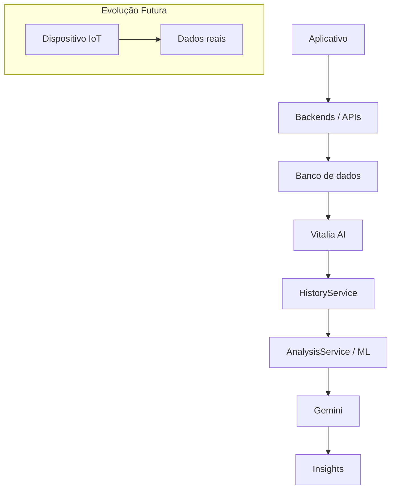

# 🐾 Vitalia AI - API de Monitoramento de Saúde Animal

A **Vitalia AI** é uma API desenvolvida em FastAPI que une Machine Learning, Inteligência Artificial Generativa (Google Gemini) e Análise de Dados para monitorar, prever e gerar insights sobre o bem-estar e comportamento de pets.

---
Link API Local
```Bash
http://127.0.0.1:8000/docs
```
Link Youtube
```Bash
https://youtu.be/oiDqsuIKKLs
```
---
👥 Integrantes do Grupo

<table>
  <tr>
    <td width="130">
      
    </td>
    <td>
      <b>Moisés Barsoti Andrade de Oliveira</b><br/>
      <b>RM:</b> 565049 &nbsp;&nbsp;|&nbsp;&nbsp;<b>Turma:</b> 2TDSPO - FIAP <br/>
    </td>
  </tr>

  <tr>
    <td width="130">
      
    </td>
    <td>
      <b>Sofia Siqueira Fontes</b><br/>
      <b>RM:</b> 563829 &nbsp;&nbsp;|&nbsp;&nbsp;<b>Turma:</b> 2TDSPG - FIAP <br/>
    </td>
  </tr>

  <tr>
    <td width="130">
      
    </td>
    <td>
      <b>Manuela de Lacerda Soares</b><br/>
      <b>RM:</b> 564887 &nbsp;&nbsp;|&nbsp;&nbsp;<b>Turma:</b> 2TDSPG - FIAP <br/>
    </td>
  </tr>
</table>

---

📋 Documentação e Requisitos do Projeto
### 1. Problema de Negócio
Falta de monitoramento preditivo e automatizado do bem-estar de pets, dificultando a detecção precoce de quedas de atividade e problemas de saúde pelos tutores ou clínicas veterinárias.

### 2. Objetivo da IA
Desenvolver um modelo preditivo capaz de analisar dados de telemetria e hábitos dos animais, gerando alertas precoces e insights explicáveis para otimizar os cuidados veterinários.

### 3. Usuários Beneficiados
Tutores de pets, equipes veterinárias e plataformas de gestão de saúde animal.

### 4. Dados Utilizados & Origem dos Dados
Registros históricos de monitoramento, peso, métricas de atividade diária, padrão de sono e consumo de água gerados por simulações do sistema.

### 5. Modelo Selecionado & Justificativa
* Modelo Selecionado: Decision Tree Classifier (guardado em models/trained/vitalia_pipeline.pkl).

* Justificativa: Selecionado automaticamente durante a comparação de modelos por apresentar o melhor desempenho com F1-Score Macro de 0.9035.

### 6. Métricas Reais (Geradas pelo evaluation.py)
* Accuracy  = ~0.90 (90.35%)
* Precision = 1.0
* Recall    = 1.0
* F1(Macro) = 0.90350
* Matriz de Confusão: Validada nas classes de monitoramento padronizadas (NORMAL, ATTENTION, RISK).

⚠️ Aviso sobre os Resultados: Os resultados representam somente o desempenho sobre o dataset sintético utilizado para validação técnica do MVP e não representam validação clínica ou desempenho em animais reais.

### 7. Integração com Google Gemini
Integração via Google GenAI SDK utilizando o modelo Gemini para traduzir análises de comportamento em recomendações de texto e respostas de Q&A humanizadas.

### 8. Variáveis de Ambiente (.env)
Para rodar a aplicação, crie um arquivo .env baseado no .env.example com as chaves:
```Bash
Snippet de código
GEMINI_API_KEY=sua_chave_aqui
API_SECRET_KEY=seu_token_da_api
```

### 9. Limitação Médica Importante
A Vitalia AI não realiza diagnóstico veterinário e não substitui avaliação profissional. As classificações representam alterações e padrões encontrados nos dados disponíveis.

### 10. Arquitetura do Sistema e Fluxo de Dados

#### MVP atual
```text
Dados simulados
↓
HistoryService
↓
AnalysisService
↓
Machine Learning
↓
Gemini
↓
FastAPI
↓
Aplicativo
```
* FUTURO
```text
Dispositivo IoT
↓
Backend
↓
Banco de dados
↓
Vitalia AI
↓
Aplicativo
```

(A integração física e automatizada IoT representa a evolução futura e ainda não está ativa nesta Sprint).

### 11. Endpoints Reais da API
* `GET /api/ai/pets/{pet_id}/insights`

* `GET /api/ai/pets/{pet_id}/dashboard`

* `GET /api/ai/pets/{pet_id}/recommendations`

* `POST /api/ai/pets/{pet_id}/predict`

* `POST /api/ai/pets/{pet_id}/ask`

* `GET /api/ai/pets/{pet_id}/trends`

### 12. Instalação, Execução & Testes
Instalação das dependências:

```Bash
pip install -r requirements.txt
```
Reprodução do Modelo e Treinamento
Para executar o fluxo completo de reprodução e treinamento dos dados e do modelo:

```Bash
python -m training.preprocessing
```
```Bash
python -m training.training
```
```Bash
python -m training.evaluation
```
E finalmente, para validar a suíte de testes:
```Bash
pytest -q
```
Execução da API:

```Bash
uvicorn api.main:app --reload
```
Fluxo Documentado:
```text
preprocessing
     ↓
training
     ↓
evaluation
     ↓
tests
     ↓
API
```

## 13. Arquitetura do Sistema



### 14. Importante:
No MVP atual, os dados provenientes da camada IoT são simulados. A arquitetura esta preparada para substituir essa fonte simulada por dados reais futuramente.

##  Fluxo de Dados: Atual vs. Arquitetura Futura

### MVP Atual
No estagio atual do MVP, o fluxo de dados opera de forma simulada e integrada aos serviçõs internos:
```text
Dados simulados -> HistoryService -> AnalysisService -> Machine Learning -> Gemini -> FastAPI -> Aplicativo
```

### 15. Arquitetura Futura:
Na evolução planejada para o projeto, a coleta de dados passará a ser automatizada por hardware real conectando-se diretamente ao ecossistema de persistência e inteligência:
```text
Dispositivo IoT -> Backend -> Oracle -> IA -> Aplicativo
```

### 16.Atenção
A integração fi­sica e automatizada (ESP32 -> Oracle -> IA) representa a evolução futura e ainda não está ativa no ambiente do MVP atual.

### 17. Detalhes Técnicos, Machine Learning & Pré-processamento
* **Histórico Individual por Pet**: Armazenamento e consulta de dados segregados por ID do pet.
* **Médias, Tendências e Alterações**: Cálculo automatizado de médias históricas, rastreamento de tendências temporais e identificação de desvios comportamentais.
* **Features & Preprocessing**: Atributos de telemetria focados em idade, peso, atividade diária, padrão de sono e sinais vitais (frequência cardíaca, frequência respiratória, temperatura e score comportamental), submetidos a etapas de limpeza e validação estrutural.
* **Decision Tree & Motivo da Escolha**: O modelo utiliza o algoritmo **Decision Tree Classifier** em virtude do seu excelente desempenho preditivo em dados tabulares, alta interpretabilidade e melhor resultado no benchmarking entre os modelos avaliados.
* **Ambiente de Execução**: Projeto configurado, executado e validado nativamente em **Python**.

### 18. Decision Tree
* O algoritmo **Decision Tree** foi o modelo vencedor na avaliação comparativa (alcançando a métrica F1-Macro de 0.9035), superando os outros algoritmos candidatos (Logistic Regression, Random Forest, KNN e SVM) na classificação do estado de saúde dos pets.

### 19. Nota sobre a Avaliação de Regressão
As métricas de avaliação de regressão (MAE, MSE, RMSE e \(R^2\)) calculadas no projeto representam o ajuste dos modelos ao histórico simulado do MVP.

### 20. Distinção entre Classificação e Alteração Histórica
* **Machine Learning**: Responsável por classificar o estado dos dados atuais (idade, peso atual, atividade atual, sono atual e água atual).
* **AnalysisService**: Responsável por comparar o registro atual com o histórico individual, explicando eventuais variações em relação à evolução temporal do pet sem que pequenas oscilações configurem obrigatoriamente um erro de modelo.


