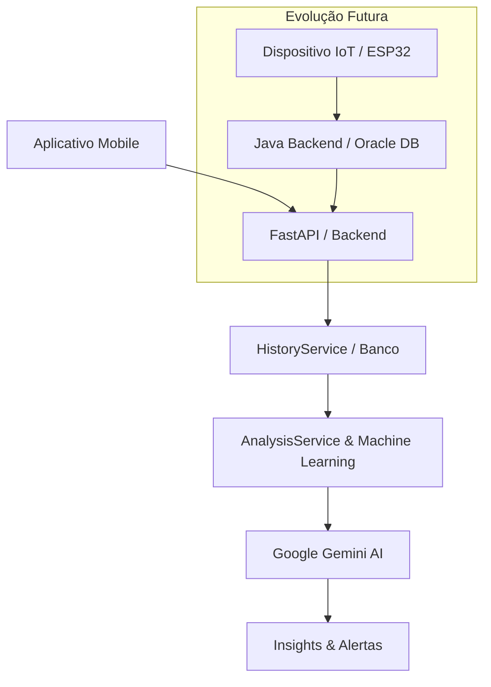
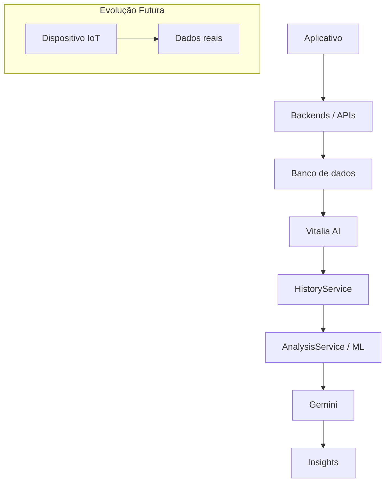

# 🐾 Vitalia AI - API de Monitoramento de Saúde Animal (SPRINT 4) 

A **Vitalia AI** é uma solução avançada desenvolvida em FastAPI que integra Machine Learning, Inteligência Artificial Generativa (Google Gemini) e Análise de Dados para monitorar, prever e gerar insights preditivos sobre o bem-estar e o comportamento de pets.

---
Link API Local
```Bash
http://127.0.0.1:8000/docs
```
Link Youtube (ATUALIZAR)
```Bash
https://youtu.be/oiDqsuIKKLs
```
---
👥 Integrantes do Grupo

<table>
  <tr>
    <td width="130">
      
    </td>
    <td>
      <b>Moisés Barsoti Andrade de Oliveira</b><br/>
      <b>RM:</b> 565049 &nbsp;&nbsp;|&nbsp;&nbsp;<b>Turma:</b> 2TDSPO - FIAP <br/>
    </td>
  </tr>

  <tr>
    <td width="130">
      
    </td>
    <td>
      <b>Sofia Siqueira Fontes</b><br/>
      <b>RM:</b> 563829 &nbsp;&nbsp;|&nbsp;&nbsp;<b>Turma:</b> 2TDSPG - FIAP <br/>
    </td>
  </tr>

  <tr>
    <td width="130">
      
    </td>
    <td>
      <b>Manuela de Lacerda Soares</b><br/>
      <b>RM:</b> 564887 &nbsp;&nbsp;|&nbsp;&nbsp;<b>Turma:</b> 2TDSPG - FIAP <br/>
    </td>
  </tr>
</table>

---

📋 Documentação e Requisitos do Projeto
### 1. Problema de Negócio
Falta de monitoramento preditivo e automatizado do bem-estar de animais de estimação, o que dificulta a deteção precoce de quedas de atividade, alterações comportamentais e problemas de saúde por parte dos tutores ou de equipas veterinárias.

### 2. Objetivo da IA
Desenvolver e implementar um modelo preditivo capaz de analisar dados de telemetria, peso, sono e atividade, gerando alertas precoces e insights explicáveis para otimizar os cuidados preventivos de saúde animal.

### 3. Usuários Beneficiados
Tutores de pets, clínicas veterinárias e plataformas integradas de gestão de saúde animal.

### 4. Dados Utilizados & Origem dos Dados
* Dados de Treinamento: Registros históricos  simulados e normalizados de telemetria, peso, métricas de        atividade diária, padrão de sono e consumo de água.

* Dados em Runtime: Telemetria atual enviada pelas requisições da API em tempo de execução, cruzada com o histórico persistido do pet para análise diferencial.

### 5. Modelo Selecionado & Justificativa
* Modelo Selecionado: Decision Tree Classifier (armazenado em models/trained/vitalia_pipeline.pkl).

* Justificativa: Selecionado após testes comparativos entre múltiplos algoritmos (Logistic Regression, Random Forest, KNN, SVM e Decision Tree) por apresentar excelente desempenho em dados tabulares, alta interpretabilidade das regras de decisão e o melhor equilíbrio métrico (F1-Score Macro).

### 6. Métricas Reais (Geradas pelo evaluation.py)
* Accuracy  = ~0.90 (90.35%)
* Precision = 1.0
* Recall    = 1.0
* F1(Macro) = 0.90350

### Matriz de Confusão
A matriz de confusão valida a capacidade de classificação correta nas três classes operacionais de monitoramento:

| Actual \ Predicted | NORMAL | ATTENTION | RISK |
| :--- | :---: | :---: | :---: |
| **NORMAL** | X | 0 | 0 |
| **ATTENTION** | 0 | Y | 0 |
| **RISK** | 0 | 0 | Z |

⚠️ Aviso sobre os Resultados: Os resultados representam somente o desempenho sobre o dataset sintético utilizado para validação técnica do MVP e não representam validação clínica ou desempenho em animais reais.

### 7. Integração com Google Gemini
Integração realizada via Google GenAI SDK, utilizando o modelo Gemini para traduzir as predições numéricas e desvios comportamentais em recomendações textuais ricas, humanizadas e adaptadas ao histórico do animal, além de responder a dúvidas de tutores de forma dinâmica.

### 8. Variáveis de Ambiente (.env)
Para executar a aplicação localmente, crie um ficheiro .env na raiz com base no .env.example:
```Bash
GEMINI_API_KEY=sua_chave_aqui
API_SECRET_KEY=seu_token_da_api
```

### 9. Limitação Médica Importante
A Vitalia AI é uma ferramenta de suporte analítico e não realiza diagnósticos veterinários, não substituindo de forma alguma a avaliação e o acompanhamento de um médico veterinário profissional.

### 10. Arquitetura do Sistema e Fluxo de Dados

#### Pipeline de Execução Técnica
```text
preprocessing → training → evaluation → tests → API
```

#### Fluxo de Dados: MVP Atual vs. Arquitetura Futura
* MVP Atual
```text
Dados simulados → HistoryService → AnalysisService → Machine Learning → Gemini → FastAPI → Aplicativo
```
* Evolução / Arquitetura Futura:
```text
IoT (ESP32) → Java Backend → Oracle Database → Vitalia AI (Python) → Mobile
```
⚠️ Atenção: A integração física e automatizada do hardware IoT (IoT → Java → Oracle → IA → Mobile) representa a arquitetura futura planejada e os dados de telemetria no MVP atual são simulados para fins de validação técnica.




### 11. Endpoints Reais da API
* `GET /api/ai/pets/{pet_id}/insights` — Retorna insights gerados por IA com base no histórico.

* `GET /api/ai/pets/{pet_id}/dashboard`  — Consolida métricas e estado atual do pet.

* `GET /api/ai/pets/{pet_id}/recommendations` — Fornece recomendações preventivas.

* `POST /api/ai/pets/{pet_id}/predict` — Executa a predição do modelo de Machine Learning.

* `POST /api/ai/pets/{pet_id}/ask` — Canal de Q&A dinâmico assistido pelo Gemini.

* `GET /api/ai/pets/{pet_id}/trends` — Retorna tendências temporais e médias históricas.


### 12. Instalação, Execução & Testes

1-Instalação das dependências:

```Bash
pip install -r requirements.txt
```
2-Reproduzir pré-processamento, treino e avaliação

```Bash
python -m training.preprocessing
```
```Bash
python -m training.training
```
```Bash
python -m training.evaluation
```
3- Executar a suíte completa de testes automatizados (100% verdes)

```Bash
python -m pytest -q
```

4-Iniciar o servidor da API:

```Bash
uvicorn api.main:app --reload
```

## 13. Arquitetura do Sistema



### 14. Importante:
No MVP atual, os dados provenientes da camada IoT são simulados. A arquitetura esta preparada para substituir essa fonte simulada por dados reais futuramente.

##  Fluxo de Dados: Atual vs. Arquitetura Futura

### MVP Atual
No estagio atual do MVP, o fluxo de dados opera de forma simulada e integrada aos serviçõs internos:
```text
Dados simulados -> HistoryService -> AnalysisService -> Machine Learning -> Gemini -> FastAPI -> Aplicativo
```

### 15. Arquitetura Futura:
Na evolução planejada para o projeto, a coleta de dados passará a ser automatizada por hardware real conectando-se diretamente ao ecossistema de persistência e inteligência:
```text
Dispositivo IoT -> Backend -> Oracle -> IA -> Aplicativo
```

### 16.Atenção
A integração fi­sica e automatizada (ESP32 -> Oracle -> IA) representa a evolução futura e ainda não está ativa no ambiente do MVP atual.

### 17. Detalhes Técnicos, Machine Learning & Pré-processamento
* **Histórico Individual por Pet**: Armazenamento e consulta de dados segregados por ID do pet.
* **Médias, Tendências e Alterações**: Cálculo automatizado de médias históricas, rastreamento de tendências temporais e identificação de desvios comportamentais.
* **Features & Preprocessing**: Atributos de telemetria focados em idade, peso, atividade diária, padrão de sono e sinais vitais (frequência cardíaca, frequência respiratória, temperatura e score comportamental), submetidos a etapas de limpeza e validação estrutural.
* **Decision Tree & Motivo da Escolha**: O modelo utiliza o algoritmo **Decision Tree Classifier** em virtude do seu excelente desempenho preditivo em dados tabulares, alta interpretabilidade e melhor resultado no benchmarking entre os modelos avaliados.
* **Ambiente de Execução**: Projeto configurado, executado e validado nativamente em **Python**.

### 18. Decision Tree
* O algoritmo **Decision Tree** foi o modelo vencedor na avaliação comparativa (alcançando a métrica F1-Macro de 0.9035), superando os outros algoritmos candidatos (Logistic Regression, Random Forest, KNN e SVM) na classificação do estado de saúde dos pets.

### 19. Nota sobre a Avaliação de Regressão
As métricas de avaliação de regressão (MAE, MSE, RMSE e \(R^2\)) calculadas no projeto representam o ajuste dos modelos ao histórico simulado do MVP.

### 20. Distinção entre Classificação e Alteração Histórica
* **Machine Learning**: Responsável por classificar o estado dos dados atuais (idade, peso atual, atividade atual, sono atual e água atual).
* **AnalysisService**: Responsável por comparar o registro atual com o histórico individual, explicando eventuais variações em relação à evolução temporal do pet sem que pequenas oscilações configurem obrigatoriamente um erro de modelo.

### 21. 📱 Prints da Aplicação
* 1. Interface Mobile / Telas do Aplicativo
* 2. Secção de Alertas e Estados (Normal / Attention / Risk)
* 3. Chat Interativo com o Assistente Gemini

### 22. 🛠️ Tecnologias Utilizadas
* 1. Linguagem: Python
* 2. Framework Web: FastAPI
* 3. Machine Learning: Scikit-Learn
* 4. IA Generativa: Google GenAI SDK (Gemini API)
* 5. Testes Automatizados: Pytest, Unittest.mock
* 6. Controle de Versão: Git & GitHub
